<div align="center">

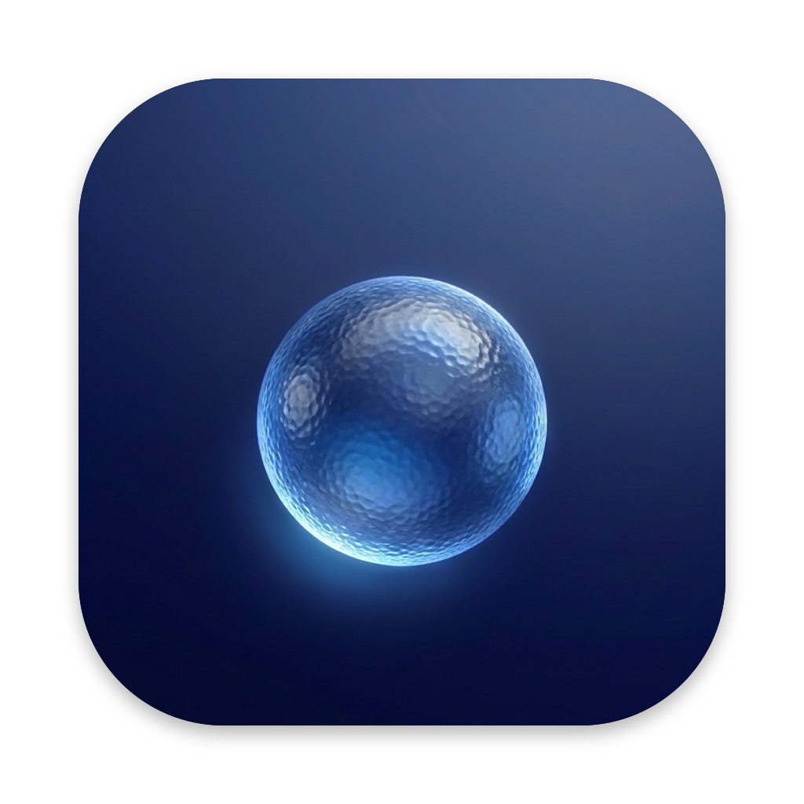

# Mini

**A small, quiet browser for the Mac.**

Chromium renders the pages. Everything you touch is native: an AppKit window, a SwiftUI sidebar,<br>Liquid Glass, and keyboard focus that behaves like a Mac app.

[](https://github.com/Isaac-Harper/mini/releases/latest)
[](#requirements)
[](#requirements)
[](LICENSE)

[Download](https://github.com/Isaac-Harper/mini/releases/latest) · [Features](#features) · [Build from source](#build-from-source) · [Keyboard](#keyboard) · [Architecture](#architecture)

<br>

[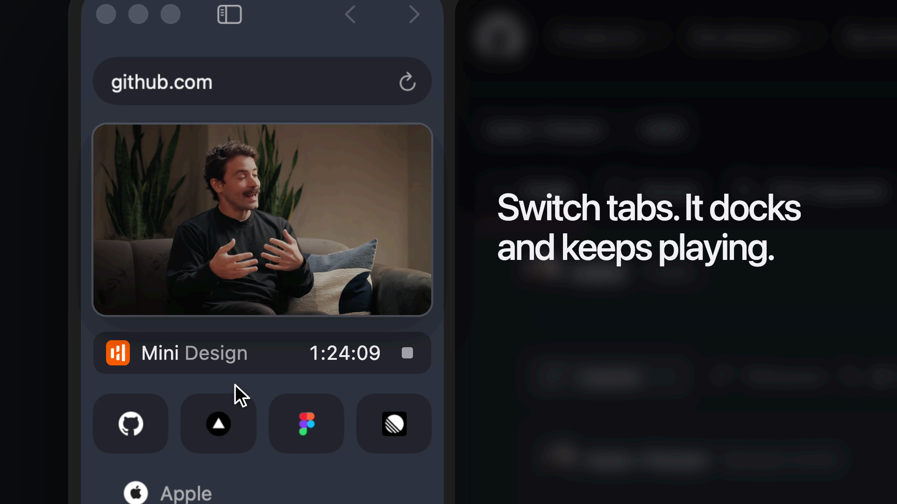](docs/media/mini-sidebar.mp4)

</div>

## Why Mini

Most browsers grow a toolbar, a tab strip, an extension store and an account. Mini goes the other way: one window, a vertical sidebar of nested tabs, and a page card that runs to the top of the screen. It is built for one person, with no extensions, sync or accounts, and it is an open source exploration of a native Swift shell over Chromium (CEF).

<table>
  <tr>
    <td width="50%">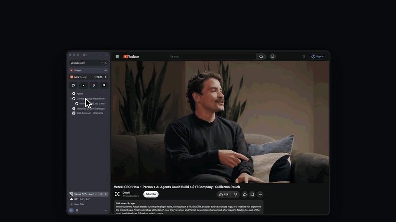</td>
    <td width="50%">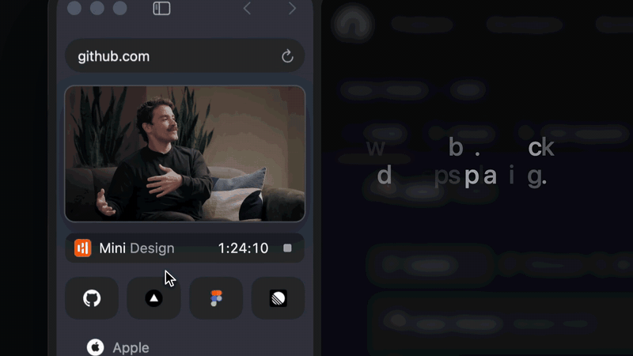</td>
  </tr>
  <tr>
    <td><b>Video that follows you.</b> Switch tabs and the Player docks in the sidebar, still playing.</td>
    <td><b>Your timer, always in view.</b> Harvest in the sidebar, with stop and resume.</td>
  </tr>
</table>

## Features

### Tabs and sidebar

- **Tree tabs.** Nest tabs by dragging one onto another, reorder by dragging, and drop onto the pinned area to pin.
- **Three kinds of tab.** Pinned tiles, Saved tabs (never archived; ⌘W unloads one back to its saved page) and regular tabs. Drag between sections to change a tab's kind.
- **Self-cleaning.** Tabs left unselected fade from 6 hours and archive at 12; find them again in the command bar. Close the Day folds untouched tabs into dated groups instead.
- **Split view.** Two tabs side by side with a draggable divider, shown as one joined row.
- **Undo for tabs.** ⌘Z brings back closes (a whole group returns in place), moves, nests, pins, splits and more.
- **Little windows.** Links from other apps open in a small floating window; ⌘O moves the live page into a tab. Drag a tab off the sidebar to tear it off, or drag a little window back to dock it, with no reload.
- **No toolbar strip.** Traffic lights and back/forward live in the sidebar's top row. With the sidebar hidden, point at the left edge to peek it out over the page.

<table>
  <tr>
    <td width="50%">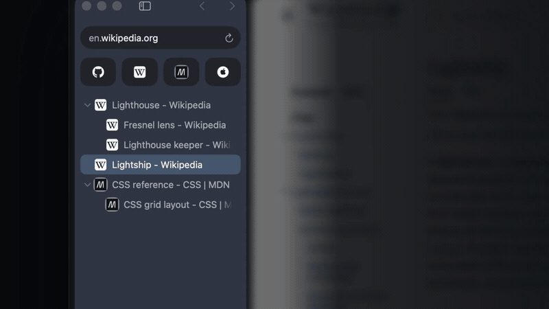</td>
    <td width="50%">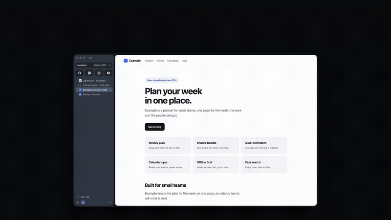</td>
  </tr>
  <tr>
    <td>Tabs nest into a tree that folds away.</td>
    <td>Two tabs, side by side.</td>
  </tr>
  <tr>
    <td width="50%">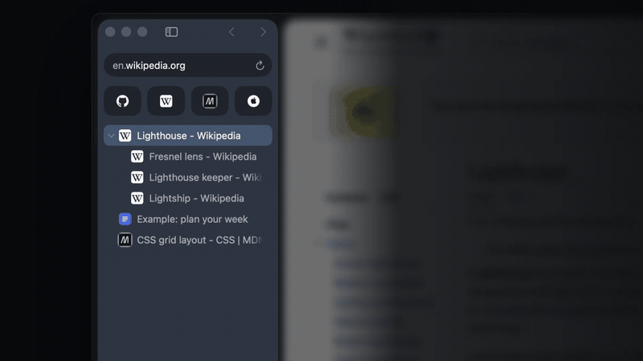</td>
    <td width="50%">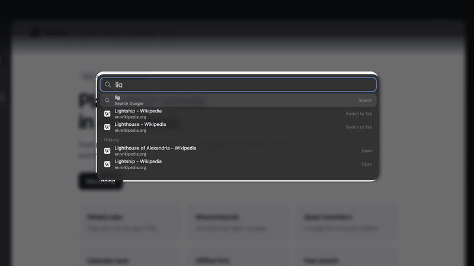</td>
  </tr>
  <tr>
    <td>Close a whole group. Undo brings it back.</td>
    <td>Type once for tabs, history and search.</td>
  </tr>
  <tr>
    <td width="50%">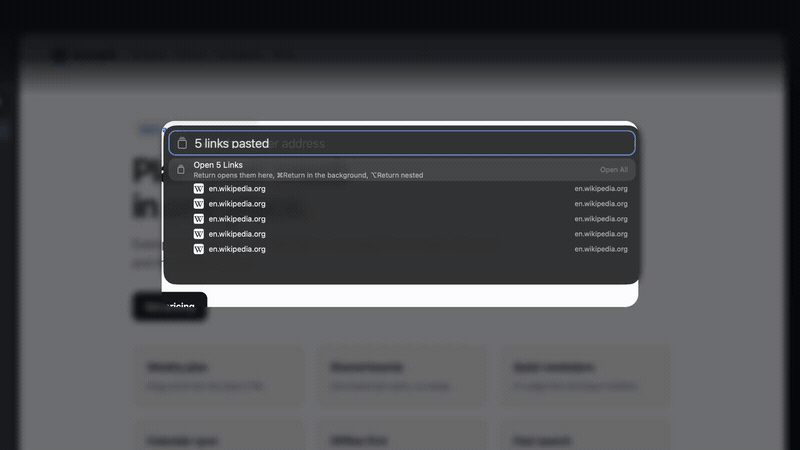</td>
  </tr>
  <tr>
    <td>Paste a list of links to open them all.</td>
  </tr>
</table>

### Spaces

- **Separate profiles.** Each space has its own tabs, pins, cookies, logins and history. Switch with ⌃1 to ⌃9 or a two-finger swipe on the sidebar.
- **Color that carries.** A space's color tints the sidebar, the selected row, the focus ring and the loading line, with the page's `theme-color` blended on top.
- **Evening tint.** After sunset the sidebar warms very slightly, easing in over 20 minutes.

<table>
  <tr>
    <td width="50%">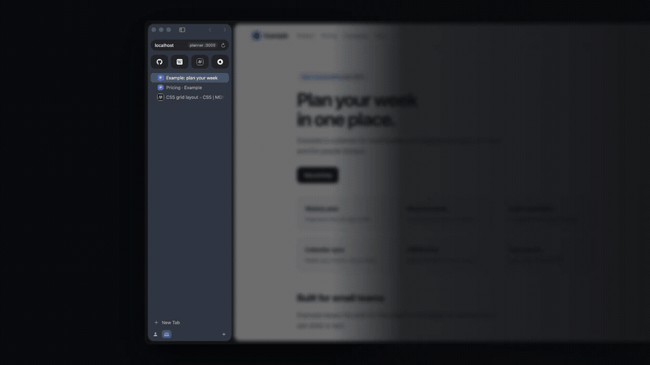</td>
  </tr>
  <tr>
    <td>Each space keeps its own tabs and color.</td>
  </tr>
</table>

### Built for web developers

- **One environment switcher.** Localhost, preview deployment and production of the same project are one chip in the address pill. ⇧⌘P cycles them, keeping the path and scroll position.
- **Dev tabs know their project.** The chip reads `mini :3000` from the server's git repository, shows the branch, opens the project in Finder or your editor, and follows the dev server to a new port.
- **Build state on rows.** With Next.js Fast Refresh or Vite, the favicon breathes while rebuilding, a red dot marks a build error in a background tab, and the pill reads `refresh 230ms` after a hot update.
- **Page health.** Uncaught errors, unhandled rejections and failed requests on dev and preview pages light a warning dot in the pill.
- **Cold and warm reloads.** Hold Option over reload (it turns into a snowflake) or press ⌥⌘R; the label reads `cold 1.4s`, then `warm 210ms`.
- **Breakpoints by hand.** Option-drag the page's right edge to resize its real viewport, with detents at 375, 768, 1024 and 1280.
- **Page Appearance.** Show one tab in light, dark or reduced motion, whatever macOS is set to.
- **Copy tools.** Copy Text Style (as CSS with OKLCH color), Copy Page as Markdown, Copy Screenshot of a page or a single element, Pick Color from anywhere on screen, and a link preview of how the URL will unfurl in Slack, iMessage or X.

<table>
  <tr>
    <td width="50%">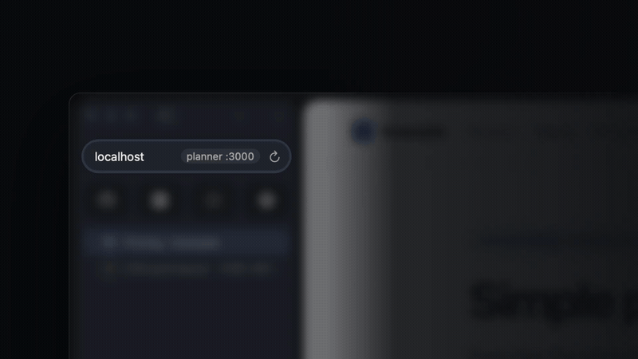</td>
    <td width="50%">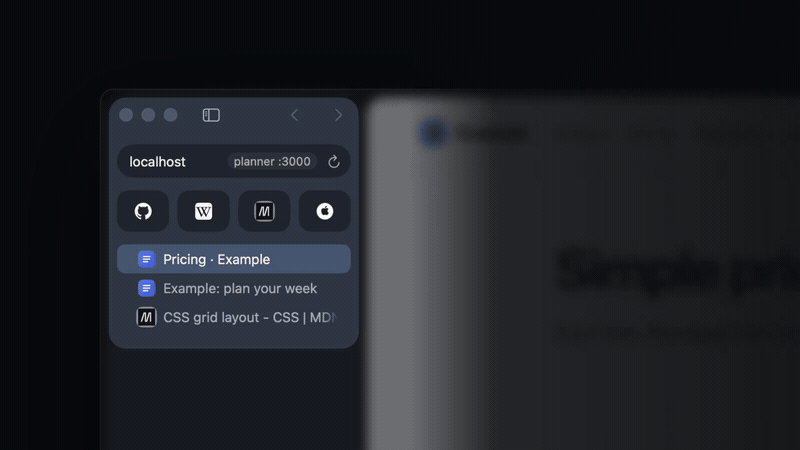</td>
  </tr>
  <tr>
    <td>⇧⌘P cycles local, preview and production.</td>
    <td>Rows show rebuilds and build errors.</td>
  </tr>
  <tr>
    <td width="50%">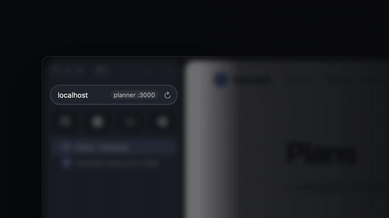</td>
    <td width="50%">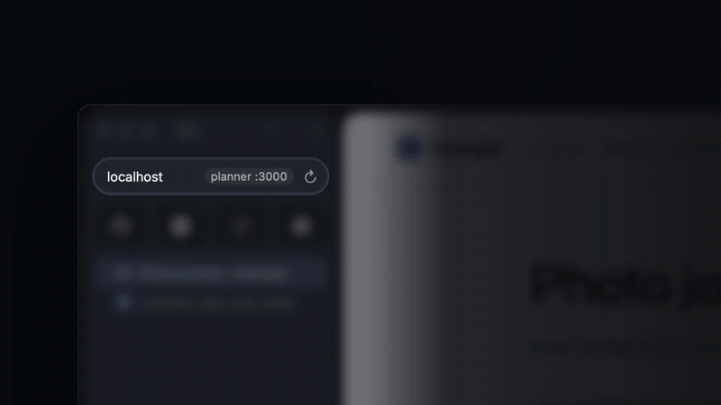</td>
  </tr>
  <tr>
    <td>Page errors light a dot in the pill.</td>
    <td>Every reload is timed, cold or warm.</td>
  </tr>
  <tr>
    <td width="50%">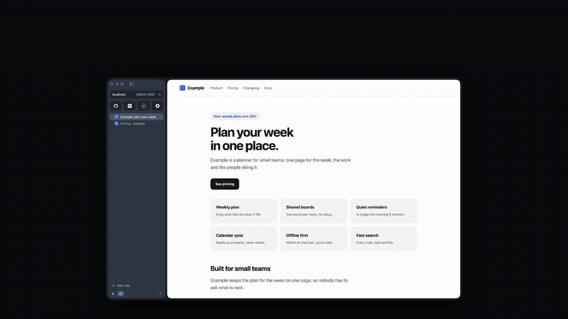</td>
    <td width="50%">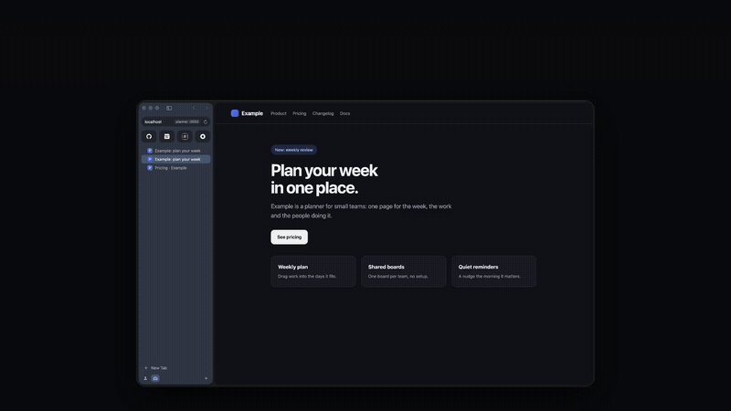</td>
  </tr>
  <tr>
    <td>Drag the page edge to test breakpoints.</td>
    <td>Show one tab in light or dark.</td>
  </tr>
  <tr>
    <td width="50%">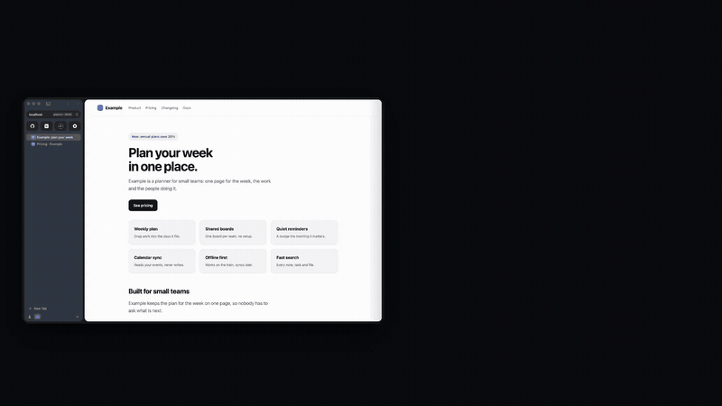</td>
    <td width="50%">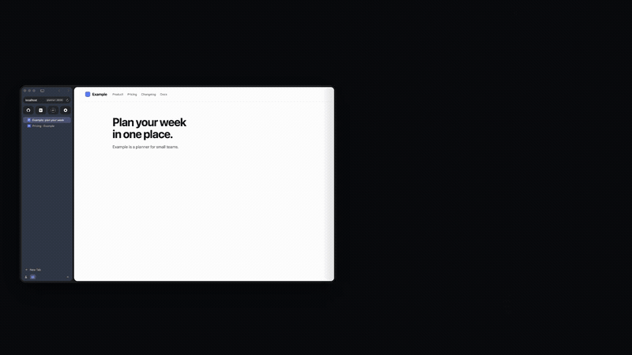</td>
  </tr>
  <tr>
    <td>Copy a screenshot of the page.</td>
    <td>See how a link will unfurl.</td>
  </tr>
</table>

### Media and calls

- **Now Playing.** Artwork, a matching tint, and play/pause for the tab that last started audio. A speaker icon mutes playing tabs.
- **Calls.** A tab in a call shows a recording dot and a microphone mute. Leave a video call and its live view docks in the sidebar.
- **AirPlay.** Hand a video with its own file or HLS source to an Apple TV, picking up where the page was.
- **Next Meeting.** The meeting on now or within the hour from your Mac's calendars, with a join button that opens the call in a little window. Off by default.

<table>
  <tr>
    <td width="50%">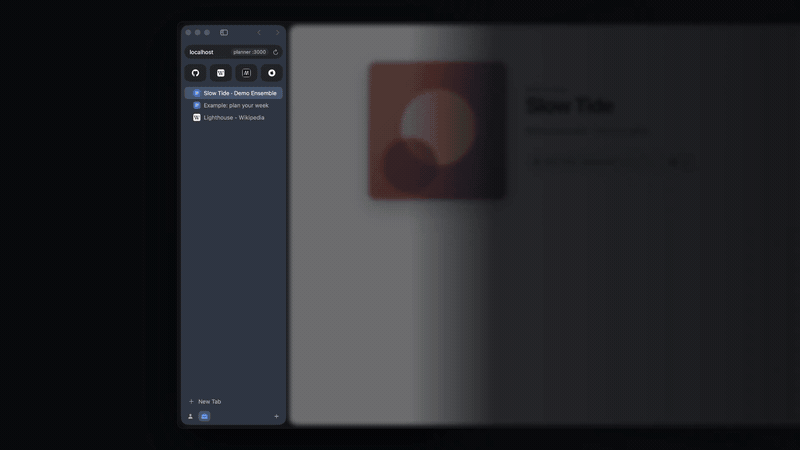</td>
    <td width="50%">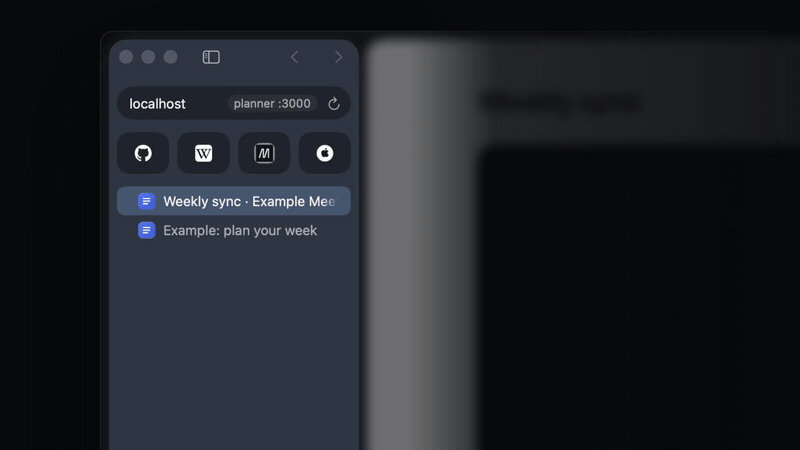</td>
  </tr>
  <tr>
    <td>What is playing stays in the sidebar.</td>
    <td>Calls get a recording dot and mute.</td>
  </tr>
</table>

### Private by default

- **Ad and tracker blocking** built in (uBlock Origin, EasyList and EasyPrivacy lists).
- **Apple Passwords** fill through a native card with Touch ID. Values are never shown, stored or logged.
- **Native permission prompts** for camera, microphone, location and the rest, reviewable in Settings.
- **Clear Data for This Site** removes one site's cookies and storage in the current space.

<details>
<summary><b>Everything else</b></summary>
<br>

- The sidebar takes on a light tint of the page's theme color, off with Reduce Transparency or Increase Contrast
- Two-finger swipe goes back and forward when the page has nothing left to scroll that way
- The address pill shows the host (hover for the full address); plain http pages other than localhost get a Not Secure mark
- A spinner on the row and a thin accent line along the top of the page while it loads
- Quiet Force Touch haptic detents when the sidebar snaps, the split divider centers, a dragged tab changes target, a swipe commits, or a tab tears off or docks
- Command bar for URLs, search (with Google suggestions), tabs, history and the `>` action list
- Paste a list of links into the command bar to open them all as lazy tabs; ⌘Return opens them in the background, ⌥Return nests them under the first
- Session restore with lazy tabs, so launch stays fast
- History per space: the History menu, a searchable History window (⌘Y) and frecency-ranked command bar matches
- Downloads progress in the sidebar; click to cancel or show in Finder
- A crashed page shows a Reload button instead of a blank tab
- Web notifications become macOS notifications once allowed for a site; clicking one returns to its tab
- A one-line weather row with a 7-day forecast on hover (Open-Meteo, city-level location)
- Fullscreen video fills the screen; the sidebar and page card come back when it ends
- Native right-click menus: links, images, selections, spelling suggestions, Inspect Element
- A small bubble shows a hovered link's address
- Mini > Settings (⌘,) gathers every preference and every stored site decision, with search and a Reset for each

</details>

## Install

Download the latest signed and notarized build from [Releases](https://github.com/Isaac-Harper/mini/releases/latest), unzip, move Mini to Applications and open it. There is no auto-update.

To make Mini your default browser, choose **Mini > Set as Default Browser**.

## Build from source

### Requirements

- macOS 26 or later on Apple Silicon
- Xcode 27 (Swift 6.4)
- Rust (stable) via rustup or Homebrew
- `cmake` and `ninja`: `brew install cmake ninja`

### Quick start

```sh
git clone https://github.com/Isaac-Harper/mini.git
cd mini
make run
```

The first build downloads the Chromium Embedded Framework (about 300 MB) into `~/.local/share/cef` and compiles its C++ wrapper, so it takes a few minutes. Later builds are incremental.

| Command | What it does |
| --- | --- |
| `make` | Builds the Rust core and the Swift shell, and assembles `build/Mini.app` |
| `make run` | Builds, then opens the app |
| `make install` | Builds, quits a running Mini, copies it to `/Applications`, registers it and relaunches |
| `make test` | Runs `cargo test` and the Swift `MiniRulesTests` |
| `make CONFIG=debug run` | Debug build |
| `make release VERSION=X.Y.Z` | Notarizes, staples and publishes `Mini-X.Y.Z-arm64.zip` as a GitHub release (needs a clean, pushed tree and the `lowlight-notary` profile) |
| `make clean` | Removes all build output |

> [!IMPORTANT]
> The build signs with the first Developer ID Application or Apple Development identity in your keychain, so the Keychain grant for Mini's cookie key survives rebuilds. Set `MINI_SIGN_IDENTITY` to pick another. Without one it signs ad hoc, every rebuild asks for Keychain access again, and pages never load until that prompt is answered.

<details>
<summary><b>Proprietary codecs (local builds only)</b></summary>
<br>

The stock CEF build plays VP8, VP9, AV1, Opus and other open formats, but not H.264, AAC or MP4. Those formats are covered by patent pools (Via LA for H.264 and AAC), and Chromium only compiles their decoders with `proprietary_codecs=true ffmpeg_branding=Chrome`. Google licenses them for Chrome; a CEF built with them and handed to other people needs its own license. So released builds always use the stock CEF, and the codecs build stays on your own machine.

`scripts/build-cef-codecs.sh` builds CEF from source with the codecs (about three hours on an M5 and about 55 GB of free disk at its peak; the 32 GB Chromium checkout is kept for rebuilds) and installs it to `~/.local/share/cef/156.0.14-codecs/cef_macos_aarch64`. Once that folder exists, `make` and `make install` use it automatically; `MINI_CEF_CODECS=0 make` builds with the stock CEF. `make release` always uses the stock CEF and refuses to publish if the bundled framework has the codecs.

</details>

## Keyboard

Browser shortcuts take priority over the page, so ⌘T and ⌘W work even when a site tries to capture them. Copy, paste and select all always go to the page; ⌘Z and ⇧⌘Z go to the page while an editable element has focus, and undo tab actions otherwise.

| Shortcut | Action |
| --- | --- |
| ⌘T | New tab (command bar) |
| ⌘L | Edit the current address |
| ⌘W | Close tab (pinned and saved tabs reset instead) |
| ⇧⌘T | Reopen closed tab |
| ⌘Z, ⇧⌘Z | Undo and redo tab actions |
| ⌃1 to ⌃9 | Switch space |
| ⌃⌘\ | Split with the last tab, or close the split |
| ⌃⌘S | Show or hide the sidebar |
| ⌘\ | Fill password |

<details>
<summary><b>All shortcuts</b></summary>
<br>

| Shortcut | Action |
| --- | --- |
| ⌥⌘T | New child tab |
| ⌘O | Move the page in a little window into a tab |
| ⌃Tab, ⌃⇧Tab, ⌥⌘↓, ⌥⌘↑ | Next and previous tab |
| ⌘1 to ⌘9 | Select tab (pinned first; ⌘9 is the last) |
| ⌥⌘→, ⌥⌘← | Indent and outdent |
| ⌥⌘\ | Collapse or expand a group |
| ⌃⌘P | Pin or unpin tab |
| ⌘D | Save or unsave tab |
| ⇧⌘D | Duplicate tab (opens right below it) |
| ⌃⇧↑, ⌃⇧↓ | Move the tab up or down among its siblings |
| ⇧⌘P | Cycle local, preview and production |
| ⇧⌘C | Copy the page address (shows its link preview) |
| ⇧⌘S | Copy a screenshot of the page |
| ⇧⌘K | Pick a color from anywhere on screen (copies OKLCH) |
| ⌘, | Settings |
| ⌘Y | Show all history |
| ⌘[, ⌘] | Back and forward (right-click or hold the arrows for the history list) |
| ⌘R, ⌘. | Reload and stop |
| ⌥⌘R | Reload without the cache |
| ⌘F, ⌘G, ⇧⌘G | Find, next, previous |
| ⌘=, ⌘-, ⌘0 | Zoom in, out, actual size (remembered per site) |
| ⌘P | Print the page |
| ⌥⌘P | Picture in picture for the largest playing video |
| ⌥⌘I | Developer tools |

In the sidebar: click its empty space (or press Tab when nothing has focus) to move the keyboard there. ↑ and ↓ move between pinned tabs and rows, ← and → collapse or expand a group (or go to its parent or first child), Return opens the tab, Delete closes it, and Esc or Tab returns to the page.

</details>

## Passwords

When a page has a login form, a key button appears in the address pill. Click it or press ⌘\ and Mini shows a small card with the site's address and two native fields. Pick a login from Apple Passwords, confirm with Touch ID, and press Return to fill the page. Mini never shows the card on its own and never stores or logs the values.

macOS does not know which website Mini is showing, so it lists all your logins instead of the matching one. Site-matched suggestions and passkeys need Apple's Web Browser Public Key Credential entitlement. Until it is granted, Mini turns off WebAuthn in pages so sites fall back to passwords and Chromium never shows its QR code or "use your phone" dialog.

## Architecture

```
core/          Rust: CEF embedding, every Chromium handler, ad blocking (cargo workspace)
  include/     mini_core.h, the C interface between Rust and Swift
shell/         Swift: window, sidebar, tabs, prompts, menus (SwiftPM package)
bundle/        Info.plist, entitlements and the app icon
scripts/       bundle.sh assembles and signs Mini.app; release and codecs scripts
```

Swift owns everything you see and every focus decision. Rust owns Chromium. They talk only through `core/include/mini_core.h`. [`AGENTS.md`](AGENTS.md) has the architecture notes and invariants.

<details>
<summary><b>Where your data lives</b></summary>
<br>

| Path | Contents |
| --- | --- |
| `~/Library/Application Support/Mini/Profile` | Cookies, cache and site data of the Personal space |
| `.../Mini/Profile/Spaces/<id>` | The same for every other space; deleting a space removes its folder |
| `.../Mini/session.json` | Spaces and their open tabs |
| `.../Mini/archive.json` | Archived tabs (newest 200) |
| `.../Mini/zoom-levels.json` | Per-site zoom levels |
| `.../Mini/permissions.json` | Per-site permission decisions |
| `.../Mini/Favicons` | Cached site icons, so restored tabs show theirs before loading |
| `.../Mini/Filters` | Ad block lists, refreshed weekly |
| `~/Downloads` | Downloads, saved without asking |

Weather caches only its last reading; coordinates are rounded to two decimals before they go to Open-Meteo and are never stored or logged. Next Meeting reads events through EventKit on demand and never stores, logs or sends them.

</details>

## Known limits

- One main window. The Personal space cannot be deleted, because it holds the original profile.
- Little windows deny permission and HTTP sign-in prompts unless the site was already allowed; open the page in Mini to answer them.
- Web notifications work only while the page is open. Service worker push for closed tabs never arrives.
- Google sometimes refuses sign-in from embedded Chromium with "This browser or app may not be secure".
- Streamed video (YouTube and other MediaSource players) cannot be handed to AirPlay; the button offers sound output and mirroring instead.

## License

[MIT](LICENSE)
